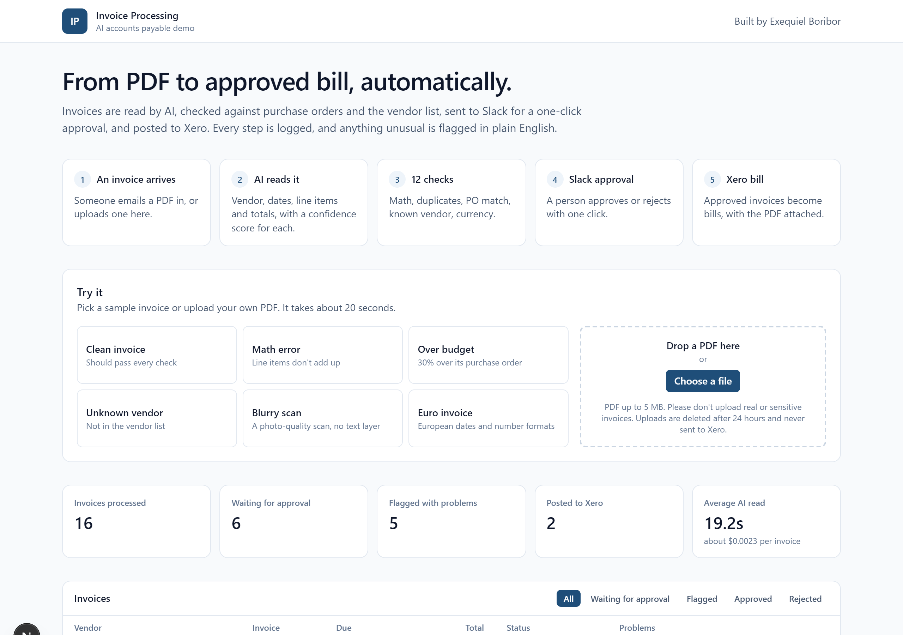
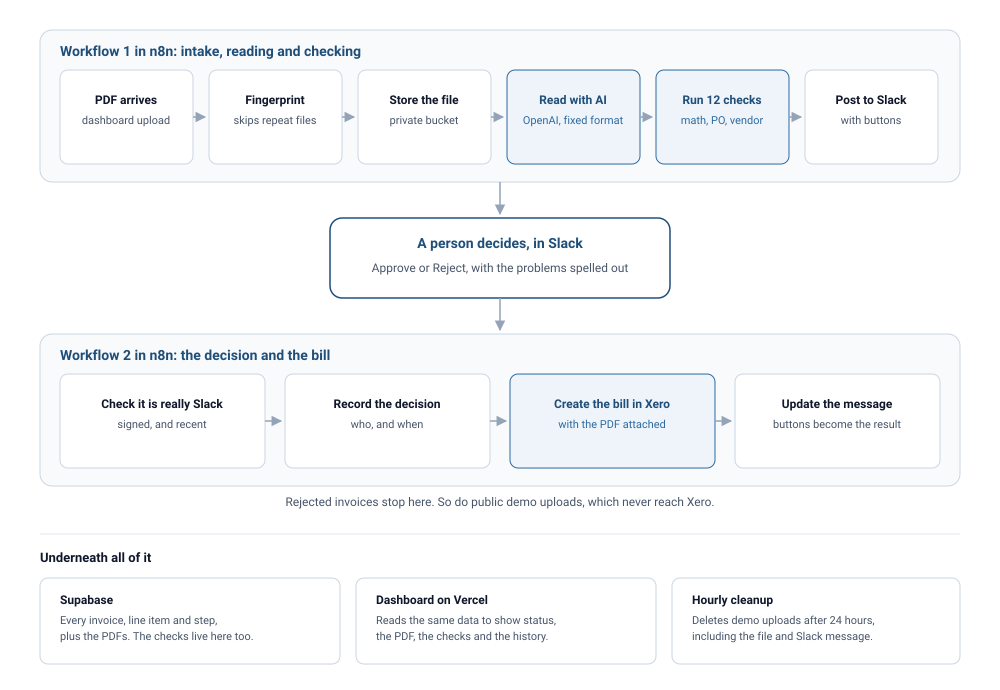
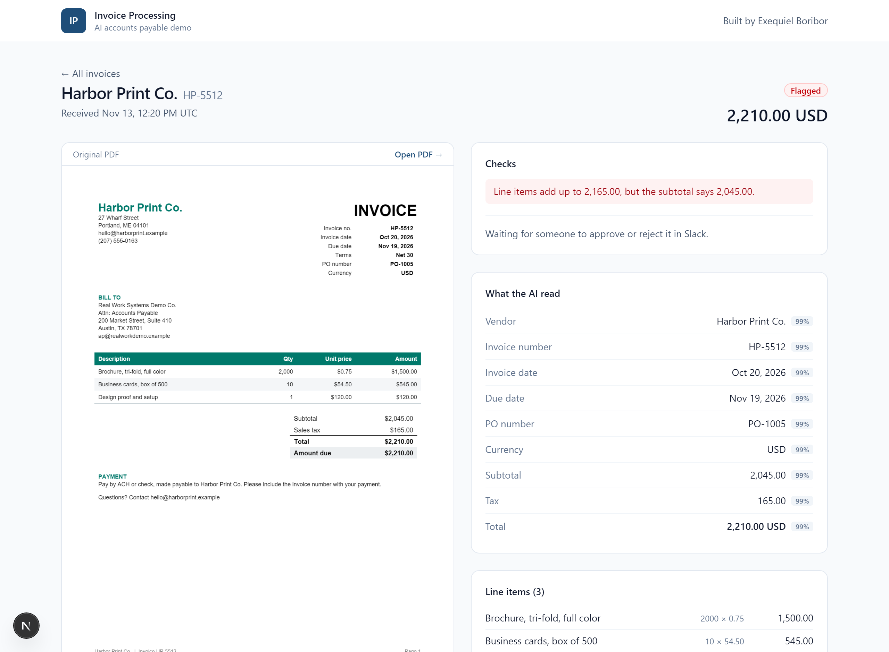
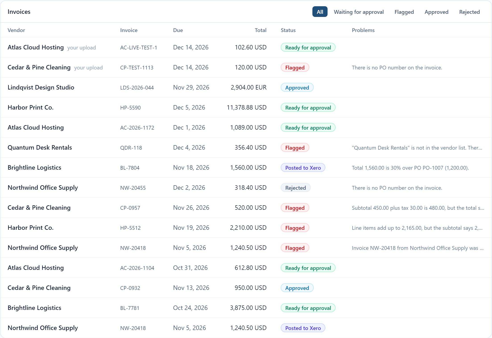

# AI Invoice Processing System

An invoice PDF goes in, a bill in the accounting system comes out. Email it or upload it, and AI reads it, the system checks it, a person approves it in Slack, and it gets posted to Xero. A live dashboard shows every invoice and where it is.

**[Try the live demo](https://ai-invoice-processing-six.vercel.app).** Pick a sample invoice or upload your own PDF and watch it go through, in about 20 seconds.



## How it fits together



## What it does
1. **Receives invoices** emailed to a watched label or uploaded on the dashboard, and skips any file it has already seen. Both routes go through one webhook, so they share every step that follows.
2. **Reads each invoice with AI** (OpenAI, with the provider swappable), pulling out the vendor, invoice number, dates, line items and totals, with a confidence score for each field.
3. **Checks the numbers:** line items add up, no duplicate invoices, the purchase order exists and matches, the vendor is known.
4. **Sends it for approval** in Slack with Approve and Reject buttons, and explains any problems in plain words.
5. **Posts approved invoices to Xero** as bills, with the PDF attached.
6. **Logs every step**, so each invoice has a full history.

## Live dashboard
A web page where anyone can try the system and see every invoice.



- **Try it:** six sample invoices (clean, math error, over budget, unknown vendor, blurry scan, euro) or your own PDF. A progress panel shows each step while it runs, about 20 seconds.
- **Invoice list** with status filters and a plain-English problem summary, plus live metrics: invoices processed, waiting, flagged, posted, and the average AI read time and cost.
- **Invoice page:** the original PDF next to what the AI read (with a confidence score per field), the check results, line items, who approved it, the Xero link, and a full history timeline.
- **Built for a public demo:** 5 tries per visitor per day, PDFs only, up to 5 MB, and a daily cap. Uploads are deleted after 24 hours by an hourly cleanup job and never reach Xero. Visitor IPs are only stored as salted hashes.
- **Private by default:** the browser never sees an API key. The page reads with a limited public key that can't see file paths, raw AI output or IP hashes, and PDFs open through short-lived signed links.

Every invoice shows its status and, where something is wrong, the reason in plain English:



## Approval in Slack
Every processed invoice lands in a Slack channel with its total, due date, PO, status and any problems in plain English, plus **Approve** and **Reject** buttons. Flagged invoices need an extra "are you sure?" click.

- **Approved** invoices become bills in Xero with the PDF attached, and the Slack message updates with a link to the bill.
- **Rejected** invoices stop there. Every decision records who made it and when.
- **Safe by design:** button clicks are checked against Slack's signature, so they can't be faked, and a second click on a decided invoice changes nothing.
- **Failures are visible:** if Xero refuses a bill, the approval is kept, the reason is saved, and the team gets an alert in `#invoice-alerts`.
- **Public demo uploads** stop at approval and never reach Xero.

## Tested, not just demoed
- **13 test invoices** cover clean cases and the problems real AP teams see: duplicates, wrong math, missing or exceeded POs, unknown vendors, a blurry scan, a 2-page invoice and a euro invoice.
- **AI accuracy is measured**, not assumed. Four OpenAI models were scored against an answer key, and the chosen one read all 13 invoices perfectly at about $0.0025 each. See [docs/extraction-eval.md](docs/extraction-eval.md).
- **12 validation checks** with plain-English reasons, like "Total 1,560.00 is 30% over PO PO-1007 (1,200.00)." See [docs/validation.md](docs/validation.md).
- **End-to-end test:** every sample goes through the live n8n workflow, and the extracted fields, final status, flags and database rows are all checked.
- **Approval test:** 7 scenarios using signed Slack clicks: approve, approve anyway, reject, demo upload, double click, a forged request, and a Xero rejection. Duplicate files, non-PDFs and bad credentials are rejected.

## Built with
n8n, OpenAI API, Supabase, Next.js 15, Tailwind CSS, PDF.js, Vercel, Slack, Xero.

## Running the dashboard locally
```bash
.venv/Scripts/python.exe scripts/sync_dashboard_env.py
```
```bash
npm install --prefix dashboard
```
```bash
npm run dev --prefix dashboard
```
Then open http://localhost:3000.

## Project layout
| Folder | What's in it |
|---|---|
| `dashboard/` | Next.js dashboard |
| `n8n/workflows/` | Exported n8n workflows |
| `supabase/` | Database schema and demo data |
| `sample-invoices/` | Fake test invoices, including edge cases |
| `docs/` | Plan, setup, validation rules and the AI accuracy test |
| `scripts/` | Python helpers: sample invoices, workflow builder, tests |
| `extraction/` | The AI prompt and output format, shared by the tests and n8n |

## Running it yourself
See [docs/SETUP.md](docs/SETUP.md).

All data in this project is fake. The Xero connection uses a demo company.
